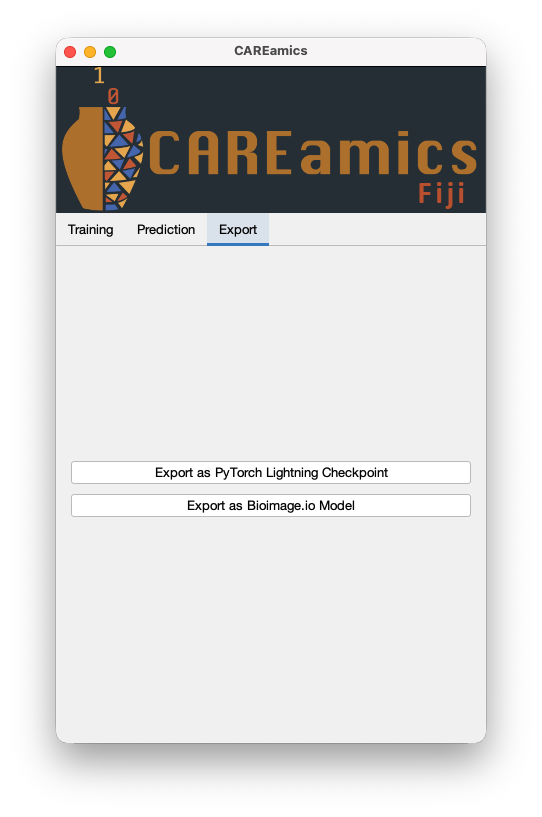
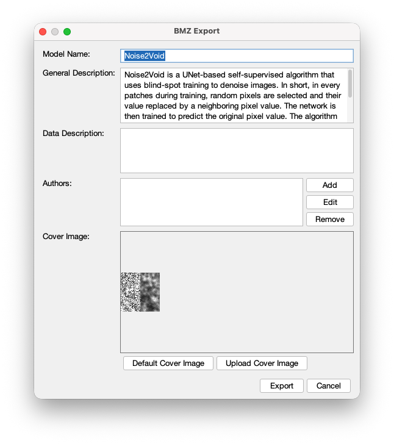

 

- **Export as PyTorch Lightning Checkpoint**: export the trained model as a PyTorch Lightning checkpoint file (*.ckpt).

- **Export as Bioimage.io Model**: export the trained model in the Bioimage.io model format.

CAREamics is a partener of the [Bioimage.io model zoo](https://bioimage.io/#/models) and contributes models to the community. You can export your trained models to the Bioimage.io model format by filling out the required information in the export dialog.

 

