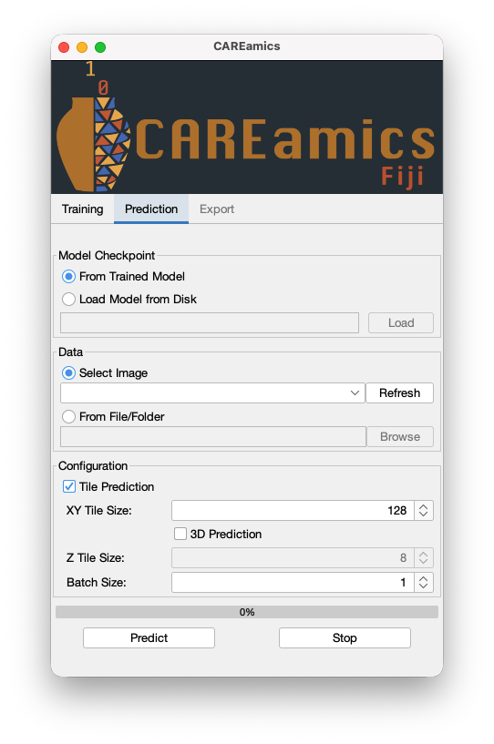

  

    <h3>Model Checkpoint</h3>
    <ul>
      <li><b>From Trained Model</b>: to use the model that you just trained</li>
      <li><b>Load Model from Disk</b>: to load a previously trained model from disk</li>
    </ul>

    

    <h3>Data</h3>
    As during training, you can select an image from those already opened in Fiji, or you can select image(s) from disk.
    
    

    <h3>Configuration</h3>
    <ul>
      <li><b>Tile Prediction</b>: if checked, the prediction will happen tile-by-tile, instead of over the whole image at once. Necessary when the data is too large to fit in memory</li>
      <li><b>XY Tile Size</b>: prediction tile size in X and Y</li>
      <li><b>3D Prediction</b>: whether the data and the model are 3D</li>
      <li><b>Z Tile Size</b>: tile size in Z dimension</li>
      <li><b>Batch Size</b>: number of tiles to predict on at each iteration (use a low number for small GPUs)</li>
    </ul>
  

  

    
  

  

