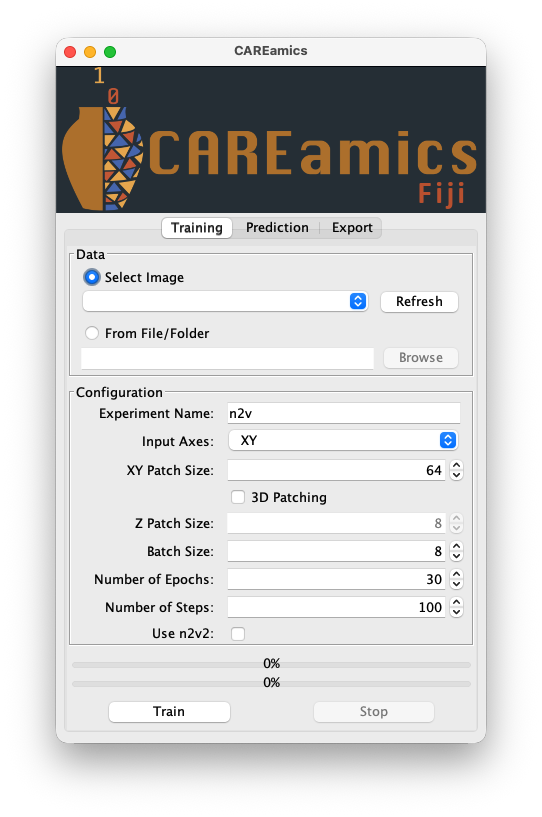

  

    

    Noise2Void is self-supervised, meaning that it trains on the noisy data itself without requiring clean target data. It relies on a classical UNet architecture, and applies a special augmentation called <i>N2V manipulate</i> that replaces the value of randomly-selected pixels with the value of one of their neighbours.
    

    <h3>Data</h3>
    
In this section you can select the data for training from any images that already opened in Fiji, or you can select a file or a folder containing images.  
    

    

    <h3>Configuration</h3>
    <ul>
      <li><b>Experiment Name</b>: the name of experiment (mandatory for <code>CAREamics</code>)</li>
      <li><b>Input Axes</b>: to select the input image(s) axes</li>
      <li><b>XY Patch Size</b>: the training patch size</li>
      <li><b>3D Patching</b>: if checked, then the training will happen over 3D patches.</li>
      <li><b>Z Patch Size</b>: the patch size in Z dimension</li>
      <li><b>Batch Size</b>: training batch size (use a small number if you have a GPU with a small memory)</li>
      <li><b>Number of Epochs</b>: the number of iterations that the model will be trained over the data</li>
      <li><b>Number of Steps</b>: the number of steps (batches) for each epoch (if it's higher than number of available batches, then it will be ignored)</li>
    </ul>

    
After setting the configuration regarding your training images, hit the "<b>Train</b>" button to start the training process.
    

    

    

    You can stop the training process by hitting the <b>"Stop"</b> button. 
    The details of the training process will be logged into the plugin's logging window.
    

  

  

    
  

