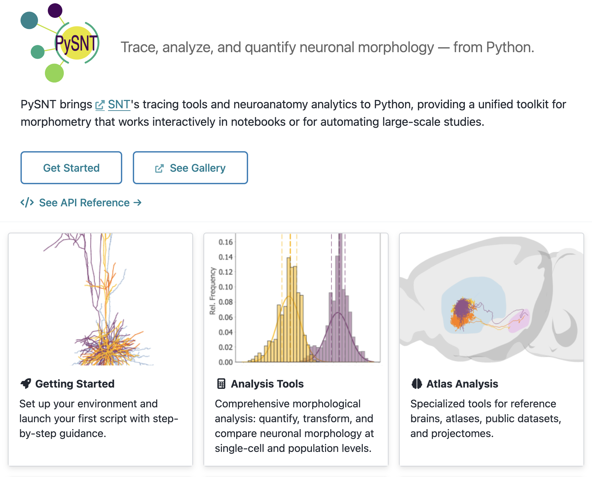

[PySNT](https://pysnt.readthedocs.io/en/latest/) is a Python wrapper for SNT that enables direct integration with the Python software ecosystem, including NumPy, SciPy, scikit-image, and more.
For details, see the [PySNT documentation page](https://pysnt.readthedocs.io/en/latest/).


New to PySNT? Start with [Computational Neuroanatomy](https://morphonets.org/computational-neuroanatomy/): a free, self-paced series of runnable notebooks, ordered by increasing complexity, that teaches neuroanatomy in Python using real data.



    

